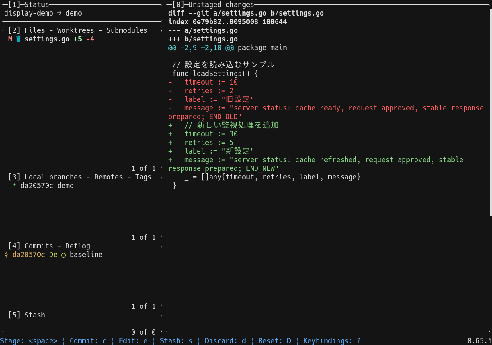
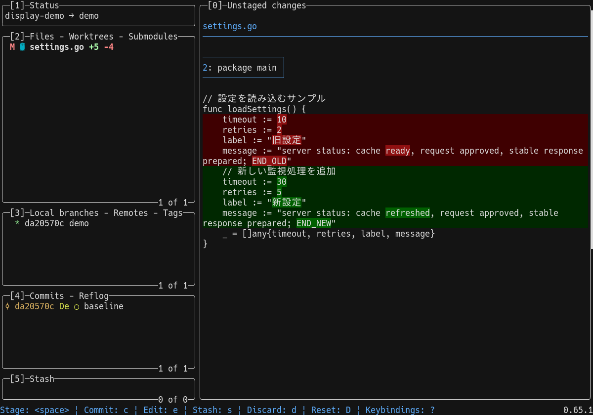
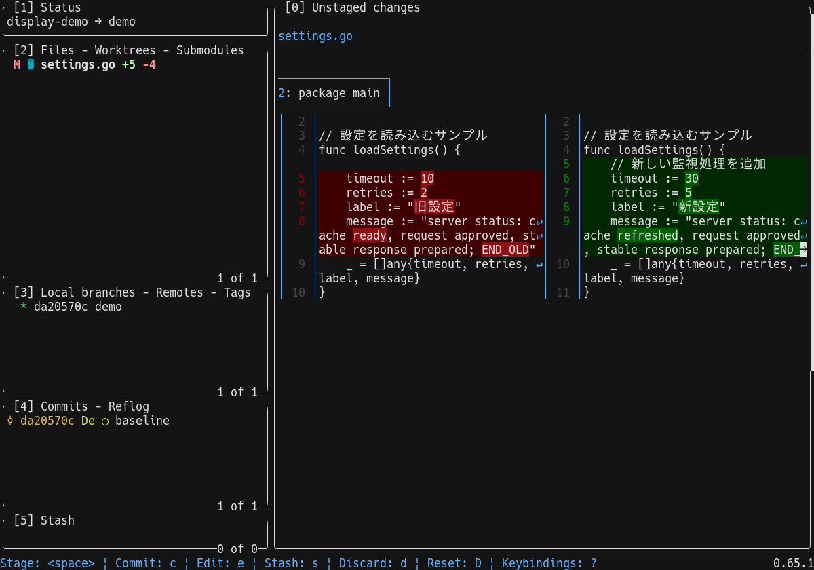
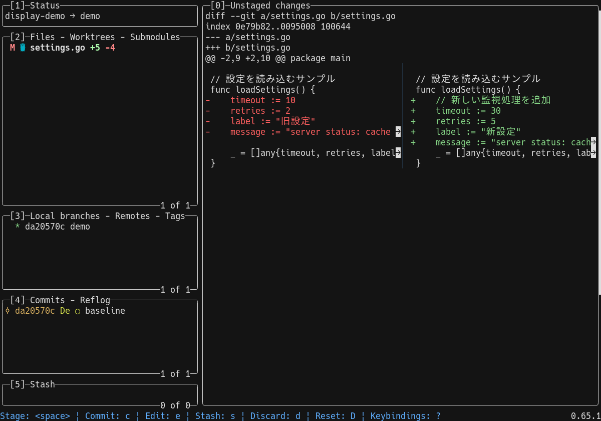
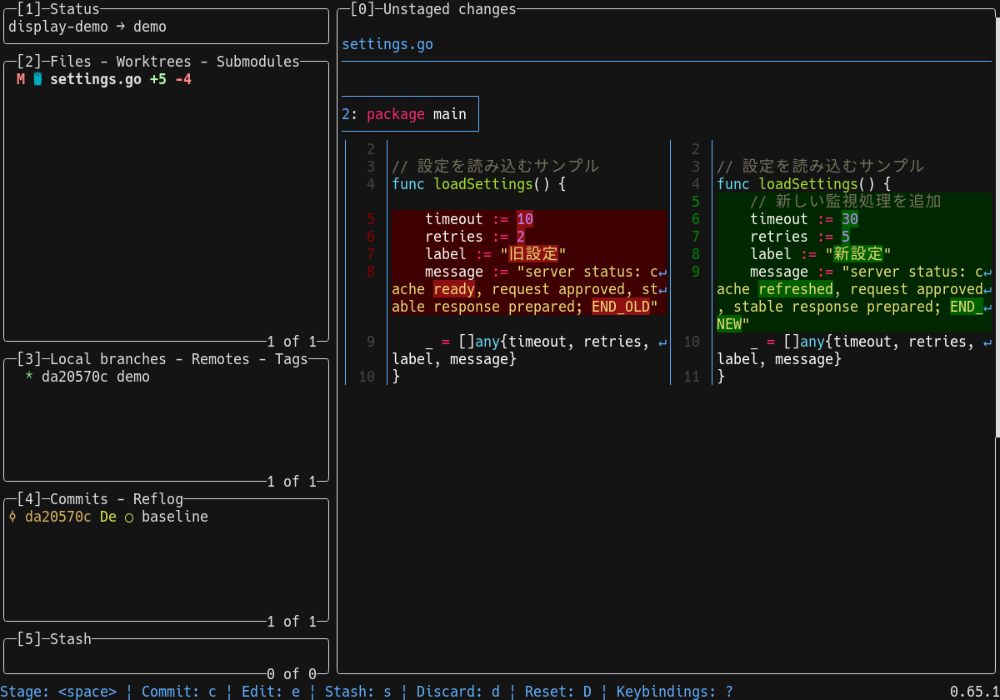

# lazygit 設定ファイル

導入・利用・更新は [AlmaLinux 10 の手順](https://github.com/ryo-aoki-pc/setup-notes/blob/main/docs/almalinux-setup.md) / [Windows 11 の手順](https://github.com/ryo-aoki-pc/setup-notes/blob/main/docs/windows-setup.md) に集約している。設定仕様・開発者向け操作・過去の検証・ロールバックはこのリポジトリで管理する。


[lazygit](https://github.com/jesseduffield/lazygit) を便利に使うための設定ファイル([`config.yml`](config.yml))です。

[設定内容・ブランチ構成](docs/reference/readme.md) / [検証記録](docs/verification/readme.md)

## 前提ツール

この設定は以下を有効化した状態になっています。未導入の場合はインストールするか、該当設定を無効化してください。

| ツール | 用途 | 未導入の場合 |
| --- | --- | --- |
| [Nerd Fonts](https://www.nerdfonts.com/)(v3系) | ファイルアイコン等の表示 | `gui.nerdFontsVersion` を `""` にする |
| [git-delta](https://github.com/dandavison/delta) | 左右比較と単語単位の変更強調を含む差分表示 | `git.diffRenderers` を `[]` に戻す |

## 導入方法

[AlmaLinux 10](https://github.com/ryo-aoki-pc/setup-notes/blob/main/docs/almalinux-setup.md#lazygit-の設定を導入する) / [Windows 11](https://github.com/ryo-aoki-pc/setup-notes/blob/main/docs/windows-setup.md#lazygit-の設定を導入する)

macOS の設定場所は `~/Library/Application Support/lazygit/config.yml`。Linux / Windows の操作は上の正本で行う。

## delta の設定と表示

このリポジトリの `config.yml` は、見やすさと速さの違う delta の左右比較3種類(標準・速度優先・見やすさ優先)と lazygit の内蔵表示を、`|` キーで切り替えて使います。引用符を二重引用符に揃えているため、Linux・macOS・Windows で同じ設定をそのまま使えます。

### 設定手順


このリポジトリの `config.yml` は、以下の4種類を設定済み。導入は [AlmaLinux 10](https://github.com/ryo-aoki-pc/setup-notes/blob/main/docs/almalinux-setup.md#lazygit-の設定を導入する) / [Windows 11](https://github.com/ryo-aoki-pc/setup-notes/blob/main/docs/windows-setup.md#lazygit-の設定を導入する)。変更時は保存して lazygit を起動し直す。

```yaml
git:
  diffRenderers:
    - command: delta --no-gitconfig --dark --paging=never --syntax-theme=none --tabs=4 --side-by-side
      name: delta side-by-side
    - command: >-
        delta --no-gitconfig --dark --paging=never --syntax-theme=none --tabs=4 --side-by-side
        --raw --inspect-raw-lines=false --word-diff-regex="(?s).+" --max-line-distance=1
        --line-numbers-left-format="" --line-numbers-right-format="│ " --wrap-max-lines=0
      colorArg: never
      name: delta side-by-side fast
    - command: >-
        delta --no-gitconfig --dark --paging=never --tabs=4 --side-by-side --line-numbers
        --syntax-theme="Monokai Extended" --wrap-max-lines=unlimited
      name: delta side-by-side readable
    - type: rawGit
      name: default
```

起動時は先頭の表示を使う。`|` で標準 → 速度優先 → 見やすさ優先 → 内蔵表示を切り替える。初期表示を変える場合は `diffRenderers` の先頭へ移す。

### Windows で使う場合


Windows の lazygit は、描画のコマンドを `cmd /s /c "<コマンド>"`(cmd.exe)で実行します。cmd.exe も delta.exe の引数の解釈も単一引用符 `'…'` を引用符として扱わないため、`'` が値に残ったり、空白で引数が分かれたりします。このため、上の設定は値を二重引用符 `"…"` で囲んでいます。二重引用符の形は Linux でも単一引用符の形と同じ表示になるため、OS ごとに書き換える必要はありません。オプションを書き足す場合も、値は二重引用符で囲んでください。

delta 本体と VC++ ランタイムの導入・確認は [Windows 11 の git-delta](https://github.com/ryo-aoki-pc/setup-notes/blob/main/docs/windows-setup.md#git-delta)で行う。

Windows 11 の実機で、scoop の delta 0.20.1 と、標準・速度優先・見やすさ優先の各コマンド(速度優先と見やすさ優先は二重引用符の形)の表示を確認しました。単一引用符の形は表示が崩れます。結果は[検証記録](docs/verification/readme.md#windows-と-raspberry-pi-の実機での検証2026-10-08)に記載しています。4項目を切り替える今の `config.yml` は、Linux の lazygit で確認しました([検証記録](docs/verification/readme.md#delta-の表示の切り替えを既定にする2026-10-09))。

### 標準の設定

`delta side-by-side` は、構文ハイライトを省いて負荷を抑えた左右比較です。行番号と単語単位の変更強調は残すため、普段の差分の確認に向く初期表示にしています。長い行は delta の既定の2回まで折り返し、収まらない部分を省略します。値に引用符を使わないため、どの OS でも同じ行のまま動きます。

### 速度を最優先にする設定

`delta side-by-side fast` は、確認した候補の中で表示速度を優先した設定です。構文ハイライト、行番号、単語単位の強調を省き、`--raw` で追加・削除を緑・赤の文字と `+/-` で表示します。`colorArg: never` と `--inspect-raw-lines=false` で Git の色入力と色移動の検査を省きます。

`--word-diff-regex="(?s).+"` は一行をまとめて扱い、`--max-line-distance=1` はバッファ内の削除行と追加行を出現順に対応付けます。似た行を探して対応付ける処理を減らすため、追加行が途中に挟まる場合などは、変更前後の対応がずれることがあります。行バッファは既定値32を使用します。

`--wrap-max-lines=0` は折り返しを止め、列幅に収まらない部分を省略します。長い行の末尾を確認する場合は差分ビューを拡大するか、見やすさ優先へ切り替えてください。

全文処理時間の比較と測定条件は[検証記録](docs/verification/readme.md#delta-の表示と性能の検証)を参照してください。Windows では git と delta の起動に時間がかかるため、小さな差分でも lazygit での表示に 0.4 秒前後かかります([Windows と Raspberry Pi の測定](docs/verification/readme.md#表示の速さ))。

### 見やすさを優先する設定

`delta side-by-side readable` は、行番号、`Monokai Extended` による構文ハイライト、単語単位の変更強調を表示します。行の類似度による対応付けは既定値を使い、途中に追加行がある場合も対応する変更前後の行を探します。

`--wrap-max-lines=unlimited` で長い行を末尾まで折り返します。表示を増やして内容を確認しやすくする設定のため、構文解析や長い行の描画に時間がかかります。大きな差分を素早く切り替える場合は、標準・速度優先または `default` を選んでください。

### 表示の比較

同じファイルの差分を、120列×40行の lazygit 画面で比較しています。ダーク背景と HackGen Console NF を使用し、コマンドログを非表示にしています。

**内蔵表示(`default`)** — 追加・削除の行を Git の色分けで表示します。



**軽量deltaの通常表示** — 構文ハイライトを省いて変更前後を一列に並べ、変更した単語を強調します。



**標準の左右比較(`delta side-by-side`)** — 構文ハイライトを省き、行番号と単語単位の強調を残した左右比較です。起動時はこの表示になります。



**速度優先の左右比較(`delta side-by-side fast`)** — 行番号と単語単位の強調を省き、変更行を順番に並べます。長い行は列幅で省略します。



**見やすさ優先の左右比較(`delta side-by-side readable`)** — 構文ハイライト、行番号、単語単位の強調を使い、長い行を折り返します。



設定形式と切替操作は [lazygit の公式資料](https://github.com/jesseduffield/lazygit/blob/v0.66.0/docs/Custom_DiffRenderers.md)、左右比較は [delta の公式資料](https://dandavison.github.io/delta/side-by-side-view.html)、各オプションは [delta の公式ヘルプ](https://dandavison.github.io/delta/full---help-output.html)を参照してください。動作確認の環境と内容は[検証記録](docs/verification/readme.md#delta-の表示と性能の検証)に記載しています。

## Excel の差分表示


Excel の差分表示・部分ステージは [AlmaLinux 10](https://github.com/ryo-aoki-pc/setup-notes/blob/main/docs/almalinux-setup.md#lazygit-の-excel-差分表示を導入する任意) / [Windows 11](https://github.com/ryo-aoki-pc/setup-notes/blob/main/docs/windows-setup.md#lazygit-の-excel-差分表示を導入する任意) に集約した。[仕様・対応条件](docs/extra/excel-diff.md)・[検証記録](docs/verification/readme.md)はこのリポジトリに残す。macOS の導入は [docs/excel-diff.md](docs/excel-diff.md#macos-の導入)。

## 必要になったら検討する項目

`config.yml` には書いていません(デフォルトのまま)。使うときは `config.yml` 内の該当キーの値を書き換えてください。

- `os.editPreset` — `e` キーで開くエディタの指定(未指定なら `$EDITOR` 等から自動判定)
- `os.copyToClipboardCmd` — SSH 先や tmux 内でも OSC52 でローカルのクリップボードへコピー
- `git.commitPrefix` — ブランチ名(例: `feature/JIRA-123`)からコミットメッセージの接頭辞を自動入力
- `git.mainBranches` / `git.autoForwardBranches` — develop 運用や全ブランチ自動 fast-forward
- `gui.statusPanelView` — ステータスパネルに全ブランチのログを表示
- `gui.theme.authorColors` / `gui.sidePanelWidth` / `keybinding` — 見た目・操作の微調整

## このリポジトリの運用

`main` は upstream 追従用です。直接編集しないでください。

- 設定の変更は `custom` からトピックブランチを切って Pull Request で取り込みます。
- 公式デフォルトからのカスタマイズ差分は `git diff main custom -- config.yml`(コミット単位なら `git log --oneline main..custom`)で確認できます。
- `custom` の `config.yml` は `main` の全項目形式を保ち、変えたい値だけを書き換えます(項目の削除・並べ替え・独自ヘッダの追加はしない)。版の互換性に必要なキーの改名・移動は[検証記録](docs/verification/readme.md)に残します。変更した値の直上に日本語コメントを 1 行付けます。
- upstream(lazygit の新バージョン)への追従は、`main` で [`scripts/fetch-upstream-config.sh`](scripts/fetch-upstream-config.sh) を実行してコミットし、
  `custom` を `git rebase main` で載せ直します(手順の詳細は `main` ブランチの README を参照)。
